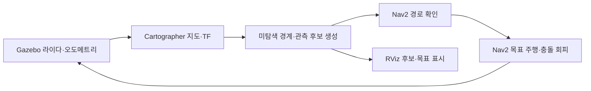

> **현재 기준(2026-10-23):** [통합 실행 안내](docs/guides/README_현재진행_통합실행.md)를 먼저 확인하세요. 현재는 단순 창고 매핑 왜곡 미해결 상태입니다. 완성 지도·AMCL 주행 성공 전입니다.

# TurtleBot3 Waffle Pi 실내 자동 매핑

Ubuntu 22.04 · ROS 2 Humble · Gazebo Classic · Cartographer · Nav2 기반의 실내 탐색 프로젝트입니다. 라이다로 생성한 지도에서 미탐색 경계를 찾고, Nav2가 도달할 수 있는 안전한 관측 위치를 자동 목표로 선택합니다.

현재 소형 창고 실험도 준비했습니다. [AWS 소형 창고 실행 안내](docs/guides/README_소형창고_실행.md)에 따라 원본 자산을 받고 Waffle Pi를 스폰할 수 있습니다. House 실행은 비교 대상으로 유지합니다.

**진행 중인 프로젝트입니다.** 초기 기둥 월드의 자동 탐색·지도 저장은 사용자 환경에서 확인했습니다. House 환경의 전체 탐색·지도 품질·출발점 복귀를 모두 통과한 최종 결과는 아직 없습니다. 최신 0.10m/s 프로필은 설정·기구학 검사를 통과했고 실제 주행 검증이 남아 있습니다.

## 실행과 읽는 순서

1. [초기화 후 0.10m/s 프로필 실행](docs/guides/README_House_010_초기화실행.md)
2. [미탐색 목표 선택과 RViz 표시](docs/guides/README_House_Nav2_자동목표.md)
3. [매핑 중 재방문 보정과 저장 지도 AMCL](docs/guides/README_House_미탐색과위치추정.md)
4. [관심 미탐색 영역 지정과 주행 진단 로그](docs/guides/README_House_주행진단.md)
5. [개발 과정과 문제 해결 기록](docs/DEVELOPMENT_JOURNEY.md)
6. [포트폴리오 작성 자료](docs/PORTFOLIO.md)

실행 파일은 우분투 `~/ros2_practice_ws`에 두는 현재 워크플로를 유지합니다. Python 스크립트와 외부 launch 파일이므로 이 코드 자체에 colcon build는 필요하지 않습니다. ROS 패키지 설치와 기존 작업공간 환경은 실행 안내서를 참고하세요.

## 현재 구조



- 로봇과 연결된 알려진 빈 공간에서 미탐색 경계를 찾습니다.
- 몸체 여유와 경계 가시성을 확인하고, 예상 추가 관측 면적과 이동 거리로 후보를 평가합니다.
- ComputePathToPose로 경로를 확인한 뒤 NavigateToPose로 목표를 보냅니다. 탐색기는 직접 `/cmd_vel`을 발행하지 않습니다.
- 방문·실패 이력으로 불필요한 목표 반복을 줄이고, 도달 가능한 후보가 없다는 이유만으로 매핑 완료를 선언하지 않습니다.
- 관심 미탐색 위치도 자동으로 고르고, 대기 목표·활성 액션·표시 경로는 하나씩 유지합니다.
- 연결된 미탐색 경계가 안정적으로 사라진 뒤에도 막힌 면의 접근 가능한 앞쪽을 순차 재관측하고 복귀합니다. 도달 실패는 미확인으로 기록합니다. 폐쇄되거나 연결되지 않은 모든 방의 탐색 완료를 보장하는 판정은 아닙니다.

## 현재 설정

| 항목 | 값 |
|---|---|
| 로봇 | 표준 Gazebo Waffle Pi |
| 선속도·회전 상한 | 0.10m/s · 0.20rad/s |
| 바퀴 반경·중심 거리 | 0.033m · 0.288m |
| 충돌 모델 | 사각 윤곽, 여유 0.01m, DWB ObstacleFootprint |
| 통신 | Cyclone DDS, ROS_DOMAIN_ID=30 |
| 위치 추정 | 매핑 중 Cartographer / 저장 지도 재사용 시 AMCL |

속도·가속도는 이번 매핑의 운용값입니다. WORLD 오도메트리 기반 시뮬레이션 검증이며 실물 적용 검증은 포함하지 않습니다.

## 코드와 검증

- `house_nav2_frontier.py`: 자동 목표 선택, 액션 상태 관리, RViz 표시, 상태 저장.
- `prepare_house_nav2_frontier.py`: Nav2 속도·충돌 윤곽 설정 생성.
- `prepare_house_wheels_010.py`, `house_waffle_pi_010.launch.py`: 모델 형상에 맞춘 구동 설정 생성과 해당 모델 스폰.
- `wheel_geometry_audit.py`: SDF 기하 감사와 수동 관측 자료 기반 기구학 추정.
- `prepare_house_revisit.py`, `prepare_house_slam_ab.py`: 재방문 보정 설정 및 원인 분리용 비교 설정.
- `tools/diagnostics/`: TF·센서·윤곽·SLAM 상태를 수집하는 읽기 전용 도구.
- `testdata/`: 실제 문제 상황에서 얻은 지도 기반 회귀 자료.

ROS를 설치하지 않은 PC에서도 순수 로직을 검사할 수 있습니다.

```bash
python -B -m unittest discover -s . -p "test_*.py"
```

현재 유지된 검사 93개는 좁은 복도·자동 관심 위치·단일 목표 액션 직렬화·막힌 면 재관측·지도 기하·후보 생성·완료 판정·표시·주행 진단·설정·바퀴 기구학·창고 자산 검사를 다룹니다. 이 검사는 ROS 액션 서버 연동·Gazebo 물리·실제 충돌 없는 주행을 대신하지 않습니다.

## 배포와 보관

우분투 복사용 최신 배포본은 `house_waffle_pi_010_bundle.zip` 하나만 유지합니다. Git에는 ZIP·캐시·새로 생성한 모델·bag을 기본적으로 제외합니다. 배포본 재생성:

```bash
python -B tools/package_release.py
```

소형 창고 배포본은 `python -B tools/package_release.py --warehouse`로 생성합니다. 두 ZIP은 서로 다른 월드의 실행 진입점이며, 내려받는 외부 창고 자산은 포함하지 않습니다.

이전 시험 코드와 중복 실행 안내는 정리했으며, 핵심 분석 원문과 실제 진단 자료는 `docs/history/`, `docs/evidence/`에 보존했습니다. 보관·삭제 기준은 [파일 안내](docs/FILE_INVENTORY.md)에 정리했습니다. GitHub 업로드·커밋은 아직 수행하지 않았습니다.


VM에서 AWS 창고가 무거우면 [단순 창고 실행 안내](docs/guides/README_단순창고_실행.md)를 사용합니다. 외부 자산 없이 8×6m 공간을 상자 13개로 생성하며, 배포 명령은 `python -B tools/package_release.py --simple-warehouse`입니다.


[지도 직선 표시와 고정 지도 주행](docs/guides/README_지도직선화_고정지도.md): `map_line_refiner.py`가 반복 관측 경계를 별도 RViz Marker와 SVG로 표시합니다. 매핑 완료 후 저장 지도·AMCL 전환 방법도 포함합니다. 배포: `python -B tools/package_release.py --map-lines`.
