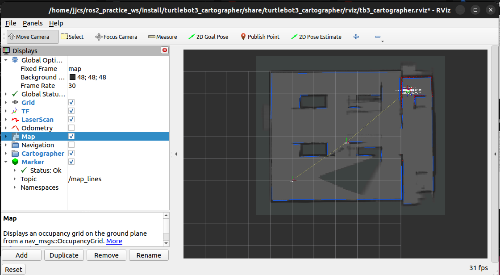

# 2026-10-23 현재 진행 기록

현재는 단순 창고에서 Cartographer 매핑 중 지도 변형이 재발한 상태입니다. 파란 직선 Marker 표시는 사용자 화면에서 작동하지만 원본 SLAM 정합을 수정하지 않습니다. 지도 왜곡 원인과 해결책은 확정하지 않았습니다.

- 현재 맵: 지붕 없는 8×6m 단순 상자 창고.
- Waffle Pi 운용 설정: 선속도 상한 0.10m/s, 각속도 상한 0.20rad/s, 바퀴 지름 0.066m, 중심 거리 0.288m.
- 통신: Cyclone DDS, ROS_DOMAIN_ID=30.
- 정상 지도 완성·탐색 종료·복귀·AMCL 주행 성공은 아직 미확인.
- 다음 조치: 탐색기 중지 → 현재 문제 지도 저장 → 설정·TF·시간 진단 → 다음 재현 시 rosbag 기록.
- 매핑과 고정 지도 주행은 별개 모드이며 VM 전체 재부팅은 전환 조건이 아님.

[현재 기준 실행 안내](../guides/README_현재진행_통합실행.md)

사용자 첨부 motion 진단의 분류 집계는 zero_command=43, rotating=4, long_rotation=10, moving=2입니다. 이 파일에는 전체 /map 격자가 없어 해당 집계만으로 지도 왜곡을 분석할 수 없습니다. 새 화면의 변형 순간과 같은 시점의 기록으로 확인된 것도 아닙니다.

이 기록과 실행 안내는 Windows 프로젝트 폴더에 저장했습니다. 우분투의 실제 지도와 bag 파일은 안내 명령 실행 후 별도로 생성됩니다. 자동으로 VM에 파일을 복사하거나 노드를 재시작하지 않았습니다.
